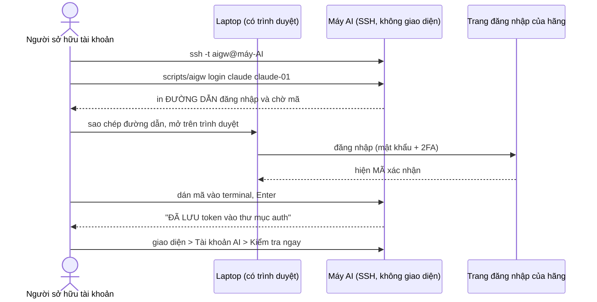

# Cổng AI — Bàn giao triển khai

Dành cho: **quản lý hạ tầng (có quyền root)** sẽ cài Cổng AI lên server, và **người sở hữu các tài khoản AI** (làm các bước đăng nhập).
Phiên bản mã: gateway/giao diện/runner 0.2.0 (hỗ trợ Claude, Grok, Antigravity, Codex). Ngày soạn: 19/11/2026.

> Cách đọc: mỗi bước ghi rõ **ai làm** — 🔒 = cần root, 👤 = người sở hữu tài khoản AI, 🔧 = người vận hành thường (không cần root). Các lệnh chạy từ thư mục gốc của kho (`/opt/aigw/ai-gateway` trong ví dụ).

## 0. Cổng AI là gì, gồm những gì

Một hệ thống nhận yêu cầu AI từ các ứng dụng của công ty (SEO Studio trước), chạy chúng qua các gói CLI đăng ký (Claude, Grok, Antigravity, Codex/ChatGPT) và trả lời theo chuẩn OpenAI. Có quản lý nhiều tài khoản, hạn mức theo ứng dụng, theo dõi sử dụng và giao diện quản trị tiếng Việt.

Mọi thứ chạy **trên MỘT máy riêng ("máy AI")** bằng Docker Compose:

| Dịch vụ | Làm gì | Ra internet? |
|---|---|---|
| `web` (Caddy) | **Cửa duy nhất** vào máy: giao diện quản trị (cổng `WEB_PORT`) và API cho ứng dụng (cổng `GATEWAY_PORT`, chỉ `/v1/*` và `/healthz`) | Không cần |
| `control` + `scheduler` | Giao diện quản trị (Laravel/Filament) và việc đồng bộ trạng thái mỗi 30 giây | Không |
| `gateway` | API OpenAI-tương-thích: xác thực khóa, hạn mức, chọn tài khoản, ghi sử dụng | **Không** (chỉ mạng nội bộ) |
| `db` | MariaDB 10.6 (cùng phiên bản với SEO Studio) | Không |
| `runner-<nhãn>` | **Mỗi tài khoản AI một runner**: chạy CLI trong container cứng hóa (hệ tệp chỉ đọc, bỏ mọi quyền, giới hạn RAM/CPU/tiến trình) | **Không trực tiếp** |
| `egress-proxy` | Đường ra duy nhất của runner; chỉ cho các tên miền trong `deploy/egress-allowlist.txt` và chặn mọi IP nội bộ | Có, theo allowlist |

Hai điểm bảo mật cốt lõi: (1) AI/CLI bị lừa hay bị khai thác cũng không ra internet tự do và không chạm được mạng nội bộ; (2) giao diện quản trị và `/internal/*` của gateway **không** lộ ra ngoài.

## 0.1 Công nghệ và cơ sở dữ liệu (quản lý cần biết cài gì)

**Trên máy AI chỉ cần cài: Docker Engine, Docker Compose v2, `python3`, `curl`, `openssl`** (xem mục 2). **Không** cần cài PHP, Node, Composer, Python thư viện hay MariaDB lên máy: tất cả nằm trong ảnh Docker, `scripts/aigw up` tự build và tải. Lần build đầu cần internet (xem mục 2, "Mạng ra từ máy AI").

| Thành phần | Công nghệ | Chạy ở đâu |
|---|---|---|
| Giao diện quản trị | PHP 8.3, Laravel 12, Filament 3 (+ filament-breezy cho 2FA), Tailwind/Vite | Container `control`, `scheduler` |
| Cửa vào, TLS | Caddy 2.8 | Container `web` |
| Gateway (API OpenAI-tương-thích) | Python 3.12, FastAPI, uvicorn, SQLAlchemy, httpx (thư viện khóa phiên bản ở `gateway/requirements.lock`) | Container `gateway` |
| Runner (chạy CLI AI) | Python 3.12 chỉ thư viện chuẩn; CLI của hãng gắn chỉ-đọc từ `/opt/cli` | Container `runner-<nhãn>` |
| Proxy chặn đường ra | Python 3.12 chỉ thư viện chuẩn | Container `egress-proxy` |
| **Cơ sở dữ liệu** | **MariaDB 10.6** (utf8mb4) | Container `db`, dữ liệu ở volume Docker `dbdata` |

**Cơ sở dữ liệu và SQL:**
- Loại: **MariaDB 10.6 ở production**, giống SEO Studio (đã chạy thật trong bản diễn tập 20/11/2026). Dev trên máy cá nhân dùng SQLite. Máy AI có MariaDB **riêng**, không dùng chung với server chính.
- **Không có tệp SQL để nạp tay.** Cấu trúc bảng nằm ở các migration Laravel (`control/database/migrations/*.php`); `scripts/aigw up` tự chạy `php artisan migrate` rồi `gateway:seed-baseline` (nạp hãng AI, khả năng, trọng số model mặc định; chạy lại nhiều lần an toàn).
- `contracts/control_schema.sql` **không dùng để cài đặt**: đó là bản mô tả cấu trúc (dạng SQLite) để test kiểm tra gateway và giao diện luôn khớp bảng. Đừng nạp nó vào MariaDB.
- Gateway chỉ **đọc** bảng cấu hình/chính sách; chỉ **ghi** `usage_events` (nhật ký sử dụng) và thời điểm dùng khóa API. Giao diện sở hữu mọi bảng còn lại.
- Sao lưu/khôi phục: `scripts/backup.sh` / `scripts/restore.sh` (mục 6.2) dùng `mariadb-dump` / `mariadb`.
- Hai tài khoản CSDL do `gwctl init` sinh mật khẩu: `gateway` (giao diện và gateway dùng chung) và `root` (chỉ cho khôi phục).

## 1. Mức kiểm chứng (nói thẳng)

Chuỗi: `đã viết mã → test giả lập đạt → tích hợp staging → người thật nghiệm thu`.

| Hạng mục | Trạng thái |
|---|---|
| Mã gateway/runner/proxy/giao diện | Đã viết. **Test tự động đạt**: runner 105, gateway 140, proxy 43, giao diện 46; kiểm tra lỗ hổng thư viện Python: sạch |
| Chạy với CLI thật (Claude, Grok, agy) qua Docker | **Đã chạy trên máy dev** (đợt thăm dò và smoke test), kể cả tìm web mức nhẹ và một bài SEO hoàn chỉnh từ SEO Studio thử |
| **Diễn tập đúng bộ triển khai này** (MariaDB 10.6, Caddy, build ảnh, migrate, gọi API, "Kiểm tra ngay", đồng bộ, sao lưu/khôi phục, kiểm tra mạng) | **Đã chạy trên máy dev ngày 19/11/2026** với runner dùng CLI **giả**; kết quả mục 9 |
| Máy AI **tách biệt thật**, tường lửa hai chiều, chặn từ server chính | **CHƯA** (cần quản lý dựng). Mục 9 là danh sách kiểm tra phải chạy |
| Chế độ TLS của Caddy (`WEB_MODE=tls`), luồng bật 2FA bằng mã | **CHƯA thử** |
| Luật tường lửa mẫu `deploy/firewall/docker-user.sh.example` | **CHƯA thử** (cần root) |
| Runner Grok/agy trong bộ triển khai mới | Đã sinh được đoạn Compose, **chưa chạy** (đã chạy bản cũ của bộ triển khai) |
| Runner **Codex** (ChatGPT) | **Đã chạy CLI thật trong container runner cứng hóa** ngày 20/11/2026: gọi được, 6 đòn tấn công đều thất bại, hết phiên được nhận biết đúng. **Chưa** chạy trong bộ Compose đầy đủ cùng gateway, chưa thấy câu chữ lỗi hết hạn mức thật, chưa thấy CLI tự làm mới token. Chi tiết: `docs/KET_QUA_THAM_DO.md` Đợt 4 |
| Nhiều tài khoản/lượng tải thật, chạy liên tục nhiều ngày, làm mới token CLI thật | **CHƯA** |
| Staging, nghiệm thu bởi người dùng thật | **CHƯA** |

Mục tiêu của tài liệu này: để quản lý đưa lên server **không phải sửa mã**, chỉ điền cấu hình. Nếu phải sửa mã để chạy được, đó là lỗi của bản bàn giao; xin ghi lại và báo.

## 2. Yêu cầu

**Máy AI** (VM hoặc máy riêng, **không** dùng chung với server chính; xem `docs/CACH_LY_MAY_CHU.md`):
- Linux x86-64 (đã thử trên Ubuntu), 4 vCPU, **8 GB RAM**, ổ đĩa **40 GB trở lên** (có mã hóa đĩa nếu được: chứa phiên đăng nhập AI). Mỗi lượt gọi CLI dùng nhiều RAM; RAM thật theo tải chưa đo.
- Docker Engine 24+ và Docker Compose v2.24+ (có `!override`), `python3`, `curl`, `openssl`.
- Đồng hồ đồng bộ NTP (lệch giờ làm sai hạn mức theo ngày). Múi giờ hiển thị đặt bằng `APP_TIMEZONE`.
- Máy AI **không** giữ khóa SSH, mật khẩu CSDL hay thông tin đăng nhập nào của server chính.

**Mạng ra từ máy AI** (qua proxy của Cổng AI, không mở rộng hơn):
- Khi cài: tải ảnh Docker (`php`, `node`, `composer`, `caddy`, `mariadb`, `python` từ registry), thư viện (`packagist.org`, `registry.npmjs.org`, `pypi.org`) lúc `build`.
- Khi chạy: `api.anthropic.com:443` (Claude), `cli-chat-proxy.grok.com:443` (Grok), `daily-cloudcode-pa.googleapis.com:443` và `www.googleapis.com:443` (agy), `chatgpt.com:443` (Codex) và `api.openai.com:443` (Codex, chỉ để nhận lỗi hết phiên nhanh). **Làm mới token** (bắt buộc, thiếu thì vài giờ sau mọi lượt gọi lỗi): `platform.claude.com:443` (Claude, **đã gặp lỗi thật ở server 21/11**), `auth.openai.com:443` (Codex) và `oauth2.googleapis.com:443` (agy) là hai dòng suy ra từ chuỗi trong CLI, chưa quan sát thật. Danh sách nằm ở `deploy/egress-allowlist.txt`; **chỉ thêm tên miền sau khi hiểu lý do**.

**Luồng mạng cần mở vào máy AI** (mọi thứ khác đóng):

| Từ | Tới | Cổng | Để làm gì |
|---|---|---|---|
| Server SEO Studio (và ứng dụng khác) | máy AI | `GATEWAY_PORT` (8771) | Gọi API |
| Quản trị viên (VPN/dải quản trị) | máy AI | `WEB_PORT` (8080 hoặc cổng TLS) | Giao diện |
| Quản trị viên | máy AI | 22 | SSH (nên qua bastion/VPN) |

## 3. Cài đặt từng bước

### 3.1 🔒 Chuẩn bị máy
```bash
# người dùng vận hành riêng, không đăng nhập bằng mật khẩu
sudo adduser --disabled-password --gecos "" aigw
sudo usermod -aG docker aigw          # lưu ý: nhóm docker tương đương root trên máy AI; chỉ cấp cho người vận hành đáng tin
sudo mkdir -p /opt/aigw /opt/cli /var/backups/aigw && sudo chown aigw: /opt/aigw /var/backups/aigw
sudo -u aigw git clone <địa-chỉ-kho-ai-gateway> /opt/aigw/ai-gateway
```
Đặt luật tường lửa (🔒, mục 5) **trước** khi khởi động dịch vụ.

### 3.2 🔒 Cài CLI của hãng vào `/opt/cli` (đúng phiên bản đã ghim)
Phiên bản và băm SHA-256 đã kiểm chứng nằm ở `runner/pins/versions.env`. **Runner từ chối chạy nếu băm không khớp.**

| Hãng | Phiên bản | Tệp đặt tại |
|---|---|---|
| Claude | 2.1.308 | `/opt/cli/claude` |
| Grok | 1.0.70 | `/opt/cli/grok` |
| Antigravity (`agy`) | 1.5.12 | `/opt/cli/agy` |
| Codex (đăng nhập ChatGPT) | 0.163.0 | `/opt/cli/codex` |

Cài bằng cách chính thức của hãng rồi chép tệp thực thi (binary đơn) tới `/opt/cli/<tên>` (`chmod 0555`, chủ sở hữu root). Rồi tính băm: `sha256sum /opt/cli/claude`. **Nếu băm khác dòng trong `versions.env`** (bản vá nhỏ của hãng) thì **dừng lại**: nâng phiên bản nghĩa là phải chạy lại bộ kiểm tra bảo mật (`runner/pins/README.md`) rồi mới đổi dòng ghim. Không tự ý bỏ qua. Chỉ cài hãng nào có tài khoản (Gemini CLI cá nhân đã bị Google ngừng, dùng `agy`).

### 3.3 🔧 Tạo bí mật và cấu hình (một lần)
```bash
cd /opt/aigw/ai-gateway
python3 scripts/gwctl.py init /opt/aigw/secrets          # tạo app_key, db_password, database_url, admin_token, runner_secrets.json
cp deploy/.env.example deploy/.env && chmod 600 deploy/.env && nano deploy/.env
```
Trong `deploy/.env`, các mục **bắt buộc điền**:
- `SECRETS_DIR=/opt/aigw/secrets`
- `AIGW_UID`/`AIGW_GID`: chạy `id -u aigw` và `id -g aigw`, điền vào (để container đọc được bí mật).
- `APP_URL`: địa chỉ người dùng gõ vào trình duyệt.
- `ADMIN_ALLOWED_CIDRS`: **dải mạng/VPN của quản trị** được vào giao diện. Để trống = khóa hết, không ai vào được.
- `WEB_BIND`, `GATEWAY_BIND`: IP của máy AI để lắng nghe (IP nội bộ). **Đừng dùng `0.0.0.0` nếu không có tường lửa.**
- `REQUIRE_2FA=true` (giữ nguyên).
- `CLI_*` và `*_SHA256`: đường dẫn CLI và băm lấy từ `runner/pins/versions.env`.
- TLS: nếu công ty có reverse proxy TLS phía trước thì để `WEB_MODE=http` và điền `TRUSTED_PROXIES`; nếu muốn Caddy tự phục vụ TLS thì `WEB_MODE=tls`, `WEB_INNER_PORT=8443`, đặt `fullchain.pem` và `privkey.pem` vào `deploy/certs/` (chưa thử chế độ này).

**SAO LƯU `/opt/aigw/secrets` NGAY** (mục 7.4). **Mất `app_key` = mọi khóa API đã cấp thành vô hiệu và không khôi phục được.** Không bao giờ chạy lại `gwctl.py init` trên máy đang dùng (script từ chối).

### 3.4 🔧 Khai báo runner cho từng tài khoản AI
Mỗi tài khoản có **một nhãn không trùng** (ví dụ `claude-01`; khuyến nghị tách tài khoản chạy bài khỏi tài khoản dùng để lập trình).
```bash
export RUNNER_UID=10001 RUNNER_GID=10001      # trùng RUNNER_UID/GID trong .env
python3 scripts/gwctl.py new-runner /opt/aigw/secrets claude claude-01
sudo chown -R 10001:10001 /opt/aigw/secrets/claude-01/auth     # 🔒 thư mục lưu phiên đăng nhập thuộc uid của runner
python3 scripts/gwctl.py list-runners
```
Lệnh sinh `deploy/runners.d/claude-01.yml` (không chứa bí mật). Lặp lại cho `grok` hoặc `agy`. `scripts/aigw` tự ghép mọi tệp trong `runners.d/`.

### 3.5 🔧 Kiểm tra máy rồi khởi động
```bash
scripts/aigw preflight        # phải 0 lỗi (lưu ý thì đọc kỹ)
scripts/aigw up               # build ảnh, chạy migrate, khởi động toàn bộ (lần đầu vài phút)
scripts/aigw health           # phải "Đạt N, không đạt 0"
scripts/aigw create-admin ten@congty.example   # hỏi mật khẩu tại chỗ (>= 12 ký tự)
```
Vào `APP_URL`, đăng nhập, **bật 2FA** (Menu người dùng → Hồ sơ của tôi). Với `REQUIRE_2FA=true` hệ thống sẽ bắt buộc.

### 3.6 👤 Đăng nhập tài khoản AI (người sở hữu làm; web KHÔNG nhận mật khẩu/token)
Phiên đăng nhập là một **tệp token** trong `/opt/aigw/secrets/<nhãn>/auth/`. Lệnh sau chạy CLI **trong một container sạch** (không keychain, không D-Bus, quyền tối thiểu) và chỉ chép tệp token vào đúng thư mục auth của runner:
```bash
scripts/aigw login claude claude-01      # hoặc: grok grok-01 | agy agy-01 | codex codex-01
```
Người sở hữu tài khoản **SSH vào máy AI có terminal** (`ssh -t`), chạy lệnh, mở đường dẫn CLI in ra **trên trình duyệt của chính mình**, đăng nhập (có 2FA), rồi dán mã vào terminal. CLI báo xong thì lệnh in `ĐÃ LƯU token`. Với `agy`: chọn "Google OAuth", đăng nhập xong thoát CLI (Ctrl+C hoặc `/quit`) để token được ghi.

| Hãng | Tệp token (trong `auth/`) | Ghi chú |
|---|---|---|
| Claude | `.credentials.json` | Lệnh bên trong: `claude auth login` |
| Grok | `auth.json` | `grok login --device-code`; tài liệu CLI ghi token hết hạn sau 7 ngày, **chưa biết có tự làm mới không** |
| Antigravity | `.gemini/antigravity-cli/antigravity-oauth-token` | Dùng **tài khoản Google riêng cho Cổng AI** (đường dẫn đăng nhập xin nhiều phạm vi quyền) |
| Codex | `auth.json` | `codex login --device-auth` (mã thiết bị, không phải dán mã). Dùng tài khoản ChatGPT riêng cho Cổng AI. **Một lượt tốn khoảng 8.500 đến 13.000 token vào** kể cả câu hỏi ngắn |

#### Server không có giao diện thì mở trình duyệt ở đâu?

**Không mở trình duyệt trên server.** Trình duyệt chạy trên **máy của người sở hữu tài khoản** (laptop). Server chỉ in ra một đường dẫn đăng nhập và chờ; người sở hữu đăng nhập trên laptop, lấy mã, rồi dán mã vào terminal đang SSH vào server.



**Chuẩn bị trước khi làm (người sở hữu tài khoản):**
- Một laptop có trình duyệt và **điện thoại/ứng dụng nhận mã 2FA** của tài khoản AI.
- Quyền SSH vào máy AI với người dùng `aigw` (quản lý cấp).
- Tài khoản AI **dành riêng cho Cổng AI** (không dùng tài khoản lập trình hằng ngày), đã đăng ký gói cần dùng.
- Quản lý đã chạy `gwctl.py new-runner` cho nhãn đó (mục 3.4) để có thư mục `auth`.

**Từng bước:**
1. **SSH có terminal**: `ssh -t aigw@<địa-chỉ-máy-AI>`. Cờ `-t` bắt buộc, vì CLI cần terminal để hiện đường dẫn và nhận mã. Nên chạy trong `tmux` (`tmux new -s login`) để đường dẫn dài không bị rớt khi mất kết nối.
2. **Chạy lệnh**: `cd /opt/aigw/ai-gateway && scripts/aigw login <claude|grok|agy> <nhãn>`.
3. **Chờ CLI in đường dẫn.** Với `agy`, chọn "Google OAuth" trong menu. Với Grok, CLI in thêm một **mã thiết bị** ngắn.
4. **Sao chép đường dẫn sang trình duyệt trên laptop.** Đường dẫn rất dài; hãy dùng cửa sổ terminal đủ rộng, chọn cả đường dẫn bằng chuột (không gõ lại tay), và **kiểm tra còn đủ tham số ở cuối** trước khi mở. Đường dẫn bị cụt (thiếu `response_type`...) sẽ báo lỗi `invalid_request` hoặc "Required parameter is missing": đây là lỗi đã gặp khi thăm dò.
5. **Đăng nhập trên trình duyệt** bằng tài khoản AI (mật khẩu và 2FA). Trang cuối hiện một **mã**.
   - Claude và agy: **sao chép mã, dán vào terminal**, Enter.
   - Grok (`--device-code`): mở trang chỉ định trên laptop và **nhập mã thiết bị** terminal đã in, không phải dán mã ngược lại.
6. Khi thành công, lệnh in `ĐÃ LƯU token vào thư mục auth`. Với `agy`, **thoát CLI** (Ctrl+C hoặc `/quit`) để token được ghi ra tệp.
7. Vào giao diện, **Tài khoản AI → <nhãn> → Kiểm tra ngay**. "Đạt" thì tài khoản chuyển "Sẵn sàng".

**Không dán mã xác nhận hay token vào chat, ticket hay email.** Mã chỉ dùng được một lần và chỉ gõ vào terminal đang chờ.

**Nếu không chạy được:**
| Hiện tượng | Nguyên nhân thường gặp | Cách làm |
|---|---|---|
| `the input device is not a TTY` | SSH không có `-t` | Thoát và SSH lại bằng `ssh -t` |
| Trang Google/hãng báo thiếu tham số hoặc `invalid_request` | Đường dẫn bị cụt khi sao chép | Chọn lại toàn bộ đường dẫn, dùng terminal rộng hơn hoặc `tmux` |
| Lệnh thoát sau khoảng 60 giây, báo `authentication failed or timed out` | Chạy `agy` ở chế độ không tương tác | Dùng đúng `scripts/aigw login agy <nhãn>` (chế độ tương tác) |
| In `KHÔNG thấy tệp token` | Đăng nhập chưa hoàn tất hoặc thoát CLI quá sớm | Chạy lại; với `agy` nhớ thoát CLI sau khi đăng nhập |
| "Kiểm tra ngay" vẫn "Hết phiên" | Token chưa lưu đúng thư mục hoặc sai quyền | Xem `ls -la <SECRETS_DIR>/<nhãn>/auth` (tệp thuộc `RUNNER_UID`, quyền 600) |
| CLI không cho đăng nhập kiểu này | Hãng đổi cách đăng nhập | **Dừng và báo lại** (ghi vào issue), không tìm đường vòng |

**Về hình ảnh minh họa:** tài liệu này **chưa có ảnh chụp màn hình thật** của từng bước, vì đăng nhập thật cần tài khoản và mã 2FA của người sở hữu nên tôi không tự chụp được. Sơ đồ ở trên là sơ đồ luồng. Khi người sở hữu đăng nhập lần đầu, hãy chụp từng bước (che mã và đường dẫn) rồi thêm vào `docs/images/` và liên kết ở đây.

**Đừng đăng nhập CLI ngay trên máy cá nhân rồi chép token sang.** Đã quan sát: `agy` trên máy có keychain dùng keychain chung của người dùng hệ điều hành (không tách theo `HOME`), nên có thể lấy nhầm tài khoản cá nhân và không tạo tệp token. Quy tắc chung: không dán mã xác thực hay token vào chat/ticket/email; dùng tài khoản riêng cho Cổng AI, tách khỏi tài khoản lập trình hằng ngày.

**Mức kiểm chứng của `aigw login`:** đường ống (tạo container, chạy CLI, chép token, quyền tệp 0600) **đã chạy thử với CLI giả**. **Chưa chạy với đăng nhập thật** của cả ba hãng trong container này (lúc thăm dò, agy đã đăng nhập được trong container sạch bằng cách dán mã; Claude/Grok đã đăng nhập bằng thư mục cấu hình riêng). Nếu CLI nào không cho đăng nhập kiểu này, báo lại để xử lý, đừng tìm đường vòng.
Khi hết phiên giao diện hiện "Hết phiên" và cảnh báo; chạy lại lệnh trên rồi bấm "Kiểm tra ngay".

**Claude tự làm mới token** (access sống khoảng 8 giờ) nhưng **mã làm mới có hạn tuyệt đối** (lần thấy: đến 15/12/2026, không dài thêm sau mỗi lần làm mới), nên **phải đăng nhập lại định kỳ, khoảng vài tuần**. Đặt nhắc lịch cho người sở hữu tài khoản. Mỗi tài khoản chỉ nên đăng nhập ở **một nơi**: mã làm mới bị xoay, một bản sao token ở nơi khác sẽ mất hiệu lực.

### 3.7 🔧 Thêm tài khoản vào giao diện và kiểm tra
Giao diện → **Tài khoản AI → Thêm**: nhãn `claude-01`, hãng, gói, số lượt song song (khởi đầu 2), địa chỉ runner `http://runner-claude-01:8800`. Tài khoản mới ở trạng thái "Chờ đăng nhập". Mở trang tài khoản → **Kiểm tra ngay**: gateway gọi một lượt rất nhỏ qua runner; đạt thì chuyển "Sẵn sàng" và hiện % hạn mức (Claude). Rồi: **Định tuyến** → tạo pool (nhóm tài khoản) và thêm tài khoản; **Ứng dụng → Thêm** (xem mục 4).

## 4. Nối SEO Studio (và ứng dụng khác)

1. Giao diện → **Ứng dụng → Thêm**: tên `SEO Studio`, cấp khả năng `text` và `web_search`, chọn pool, đặt hạn mức (ban đầu để rộng rồi siết sau khi có số liệu), **tạo khóa**. Khóa hiện **một lần**: chép vào trình quản lý bí mật.
2. Pool cho SEO Studio nên **chỉ có Claude**: khi đó tên model không tiền tố (`sonnet`, `haiku`) dùng được; pool nhiều hãng thì phải ghi `claude:sonnet`.
3. Trên server SEO Studio: thêm `<IP-máy-AI>:<GATEWAY_PORT>` vào `AI_PRIVATE_BASE_URL_ALLOWLIST` (cần tạo lại container để nhận biến môi trường), rồi:
```bash
php artisan agent:claude-setup --base-url=http://<IP-máy-AI>:<GATEWAY_PORT>/v1 --model=sonnet --roles=writer,strategist --test
```
   (khóa truyền qua biến `CLAUDE_BRIDGE_TOKEN` hoặc `--token-file`, **không** để trong lịch sử shell). Lệnh giữ nguyên model dự phòng đang có.
4. Chạy thử **một bài**, kiểm tra trên giao diện Cổng AI: nhật ký có lượt `text`/`web_search` của ứng dụng đó.
5. Chạy **song song** với cầu nối cũ một thời gian. Quay lại cầu nối cũ = chạy lại `agent:claude-setup` với `--base-url` cũ và khóa cũ.
6. Khi ổn: tắt cầu nối cũ (`systemctl --user disable --now claude-bridge` trên server cũ).

Giới hạn hiện tại: chỉ **văn bản** và **tìm web mức nhẹ** (tìm phía hãng, không tải nội dung trang). Chưa có stream, ảnh. Tìm web không có WebFetch nên đoạn trích đôi khi chỉ là tiêu đề/URL.

## 5. 🔒 Tường lửa và bảo vệ mạng

Docker **bỏ qua ufw/firewalld** cho các cổng đã công bố; luật phải đặt ở chuỗi `DOCKER-USER`. Mẫu ở `deploy/firewall/docker-user.sh.example` (**chưa thử, cần root**): chỉ cho IP server SEO Studio vào `GATEWAY_PORT` và dải quản trị vào `WEB_PORT`. Cho chạy lại mỗi lần khởi động (unit systemd oneshot hoặc `netfilter-persistent`). Ngoài ra:
- SSH chỉ qua VPN/bastion, đăng nhập khóa công khai, tắt mật khẩu.
- Máy AI **không được** truy cập tới mạng nội bộ của server chính (chặn chiều đi ở tường lửa mạng). Đây là lớp ngoài cùng; các lớp trong Docker chỉ là bổ sung. Xem `docs/CACH_LY_MAY_CHU.md`.
- Nếu mạng có metadata đám mây (`169.254.169.254`) hãy chặn từ máy AI ở cấp mạng.

## 6. Vận hành hằng ngày

| Việc | Lệnh / cách làm |
|---|---|
| Trạng thái tổng thể | `scripts/aigw health` |
| Xem log | `scripts/aigw logs gateway` (hoặc `control`, `web`, `runner-<nhãn>`) |
| Khởi động lại một dịch vụ | `scripts/aigw restart gateway` |
| Dừng toàn bộ (giữ dữ liệu) | `scripts/aigw down` |
| Lệnh artisan | `scripts/aigw artisan gateway:sync` |
| Tài khoản hết phiên | `scripts/aigw login <hãng> <nhãn>` (3.6), rồi **Kiểm tra ngay** |
| Tắt khẩn cấp | Giao diện → Hệ thống → Dừng khẩn cấp (từng ứng dụng/tài khoản/toàn bộ) |
| Thêm tài khoản AI mới | 3.4 → 3.6 → 3.7, rồi `scripts/aigw up` |
| Đổi khóa API của một ứng dụng | Giao diện → Ứng dụng → tạo khóa mới → cập nhật ứng dụng → thu hồi khóa cũ |

Dải trạng thái trên cùng của giao diện cho biết kết nối gateway: **"Gateway kết nối"** (xanh) hoặc **"Gateway mất kết nối"** (đỏ, kèm cảnh báo nghiêm trọng). Đồng bộ chạy mỗi 30 giây.

### 6.1 Nâng cấp
```bash
cd /opt/aigw/ai-gateway && git fetch && git checkout <thẻ-phiên-bản>
scripts/backup.sh                 # luôn sao lưu trước
scripts/aigw up                   # build lại, tự migrate CSDL
scripts/aigw health
```
Nâng phiên bản CLI của hãng: **không** làm trước khi chạy lại bộ kiểm tra bảo mật (xem 3.2).

### 6.2 Sao lưu và khôi phục (đã chạy thử thật trên bản diễn tập)
```bash
echo "<cụm-từ-mật-khẩu-dài>" > /opt/aigw/backup-passphrase && chmod 600 /opt/aigw/backup-passphrase
AIGW_BACKUP_PASSPHRASE_FILE=/opt/aigw/backup-passphrase scripts/backup.sh /var/backups/aigw
```
Tạo `aigw-db-<giờ>.sql.gz` (CSDL) và `aigw-secrets-<giờ>.tar.gz.enc` (thư mục bí mật, **mã hóa AES-256**; **bao gồm cả phiên đăng nhập AI** nên rất nhạy cảm). Đặt lịch hằng đêm: `deploy/systemd/aigw-backup.{service,timer}` (🔒 cài vào `/etc/systemd/system`, sửa đường dẫn nếu khác). **Chép bản sao lưu ra ngoài máy AI** và giữ cụm từ mật khẩu **ở nơi khác**.
- Khôi phục CSDL: `scripts/restore.sh <tệp .sql.gz>` (hỏi xác nhận, ghi đè, tự khởi động lại).
- Khôi phục bí mật: `openssl enc -d -aes-256-cbc -pbkdf2 -pass file:<tệp cụm từ> -in <tệp .enc> | tar -xz -C /opt/aigw/secrets`.
- **Diễn tập khôi phục** trên máy khác mỗi quý.

## 7. Giám sát (hiện tại ở mức tối thiểu)
- Chưa có Prometheus/Grafana/cảnh báo ra ngoài. `scripts/aigw health` có thể đặt vào cron/monitoring của công ty (thoát khác 0 khi có lỗi).
- Cảnh báo trong giao diện: hết phiên, ngắt mạch (CLI vượt quyền), mất kết nối gateway. Webhook thông báo cấu hình ở Hệ thống → Cài đặt.
- Khi có `account_tripped` ("bị ngắt mạch"): **dừng tài khoản đó** và báo bảo mật. Đây là dấu hiệu runner thấy CLI làm điều không được phép.

## 8. Giới hạn đã biết
1. Một tiến trình gateway: cooldown, bộ đếm rpm, chỗ chạy song song nằm **trong bộ nhớ**, mất khi khởi động lại (lệch giờ ngắn). Muốn mở rộng phải chuyển sang Redis.
2. Chưa có kiểm tra sức khỏe tài khoản **định kỳ**: chỉ khi bấm "Kiểm tra ngay" hoặc khi có lượt gọi thật. Hết phiên chỉ được phát hiện khi gọi.
3. Runner khai báo qua tệp Compose (`gwctl new-runner` sinh sẵn); thêm tài khoản chưa làm được hoàn toàn từ giao diện, vì cần đăng nhập và quyền Docker.
4. Chỉ văn bản và tìm web mức nhẹ. agy đưa prompt qua đối số dòng lệnh (giới hạn khoảng 100.000 byte).
5. Giao diện và gateway **dùng chung một tài khoản CSDL** (`gateway`, đủ quyền trên `aigw`). Thiết kế muốn gateway chỉ đọc bảng chính sách và chỉ ghi `usage_events`; **chưa tách quyền**. Gateway chạy trong mạng nội bộ nên rủi ro thấp, nhưng chưa đạt thiết kế.
6. **Codex:** các cờ tắt công cụ gắn với phiên bản **0.163.0**; công cụ không gỡ được khỏi danh sách, chỉ vô hiệu hóa cách chạy (lớp chính là container). Nâng phiên bản Codex phải chạy lại bài thử an ninh ở `KET_QUA_THAM_DO.md` Đợt 4. Chỉ khả năng `text`.
7. `GATEWAY_CHECK_MODELS` mặc định có tên model của Grok/agy lấy từ đợt thăm dò; cần xác nhận khi dựng runner Grok/agy (đặt lại nếu sai).
8. Container `gateway` nằm trong hai mạng nội bộ; cửa vào là Caddy. Nếu Caddy bị chiếm, đường tới gateway vẫn bị giới hạn ở `/v1/*` và `/healthz` trong cấu hình hiện hành, nhưng Caddy có đường ra internet: đừng đặt thêm bí mật vào `web`.

## 9. Kiểm tra sau khi cài (làm rồi ghi kết quả vào biên bản nghiệm thu)

Các kiểm tra 1–5 **đã đạt trên bản diễn tập** (máy dev, runner dùng CLI giả); phải chạy lại trên máy AI thật. 6–9 **chưa từng chạy**.

| # | Kiểm tra | Cách làm | Kết quả đúng |
|---|---|---|---|
| 1 | Sức khỏe | `scripts/aigw health` | Không có dòng KHÔNG |
| 2 | `/internal` và `/metrics` không lộ | `curl -s -o /dev/null -w '%{http_code}' http://<máy-AI>:<GATEWAY_PORT>/internal/state` | `404` |
| 3 | Gateway không có đường ra internet | `docker exec <gateway> python -c "import socket;socket.create_connection(('1.1.1.1',80),timeout=4)"` | Lỗi `OSError` |
| 4 | Runner không ra internet trực tiếp | như trên với container runner | Lỗi `OSError` |
| 5 | API chạy | gọi `/v1/chat/completions` bằng khóa thử | `200` và có dòng trong Nhật ký |
| 6 | Tường lửa: chỉ IP SEO Studio vào được cổng API | từ máy khác `curl http://<máy-AI>:<GATEWAY_PORT>/healthz` | Bị chặn/timeout |
| 7 | Tường lửa: máy AI không tới được mạng nội bộ của server chính | từ máy AI `curl`/`nc` tới IP và cổng của server chính | Bị chặn |
| 8 | Proxy chặn tên miền ngoài allowlist | từ runner qua proxy tới `example.com:443` | Bị từ chối, log có `TU_CHOI` |
| 9 | 2FA và giới hạn mạng quản trị | đăng nhập từ ngoài `ADMIN_ALLOWED_CIDRS`; đăng nhập chưa bật 2FA | Bị từ chối / bắt buộc bật 2FA |

Phần còn lại của kiểm chứng cách ly máy AI: `docs/CACH_LY_MAY_CHU.md` mục 6.

## 10. Sự cố thường gặp
| Hiện tượng | Nguyên nhân thường gặp | Cách xử lý |
|---|---|---|
| `aigw up` dừng ở `migrate` "didn't complete successfully" | Container không đọc được bí mật | `AIGW_UID/GID` trong `.env` phải bằng chủ sở hữu `SECRETS_DIR` (preflight báo sẵn) |
| Runner khởi động rồi thoát, log nói băm CLI sai | CLI khác phiên bản đã ghim | Dùng đúng bản trong `runner/pins/versions.env` (xem 3.2) |
| Đăng nhập giao diện bị 403 | Chưa đặt `ADMIN_ALLOWED_CIDRS` hoặc IP không thuộc dải | Sửa `.env`, `scripts/aigw up` |
| "Gateway mất kết nối" | `gateway` chết hoặc `admin_token` lệch | `scripts/aigw logs gateway`; không đổi `admin_token` khi hệ thống đang chạy |
| Gọi API trả `no_account_available` | Tài khoản "Chờ đăng nhập"/"Hết phiên"/"Đang nghỉ", hoặc pool rỗng | Bấm "Kiểm tra ngay"; xem pool của ứng dụng |
| Gọi API trả `invalid_api_key` | Khóa sai, đã thu hồi, hoặc `app_key` đã bị đổi | Tạo khóa mới; nếu `app_key` mất, mọi khóa cũ vô hiệu |
| Hết phiên liên tục, hoặc mọi lượt Claude lỗi `502` sau vài giờ | Token OAuth hết hạn và proxy chặn địa chỉ làm mới (`platform.claude.com`) | Thêm các dòng làm mới token vào `deploy/egress-allowlist.txt`, tạo lại `egress-proxy`; nếu vẫn lỗi thì `scripts/aigw login ...` (3.6) |
| `web` báo không chạy được `caddy` | Bỏ `cap_add: NET_BIND_SERVICE` | Giữ nguyên cấu hình trong `docker-compose.yml` |

## 11. Bản đồ tệp
| Đường dẫn | Nội dung |
|---|---|
| `deploy/docker-compose.yml` | Bộ dịch vụ; `deploy/runners.d/*.yml` các runner; `deploy/.env` cấu hình (không commit) |
| `deploy/egress-allowlist.txt` | Tên miền runner được nối ra |
| `deploy/firewall/`, `deploy/systemd/` | Mẫu tường lửa, lịch sao lưu |
| `scripts/aigw` | Lệnh vận hành (`up`, `health`, `logs`, `login`, `create-admin`, `artisan`) |
| `scripts/gwctl.py` | Tạo bí mật và runner |
| `scripts/preflight.sh`, `backup.sh`, `restore.sh` | Kiểm tra máy, sao lưu, khôi phục |
| `control/` | Giao diện quản trị (Laravel/Filament); `gateway/`, `runner/`, `egress-proxy/` |
| `docs/THIET_KE.md`, `CACH_LY_MAY_CHU.md`, `GATEWAY_RUNNER.md`, `KET_QUA_THAM_DO.md` | Thiết kế, cách ly, chi tiết gateway/runner, kết quả thăm dò CLI |
